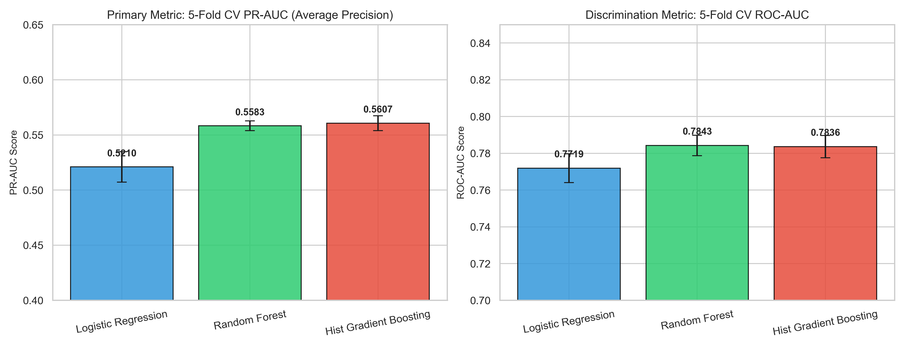
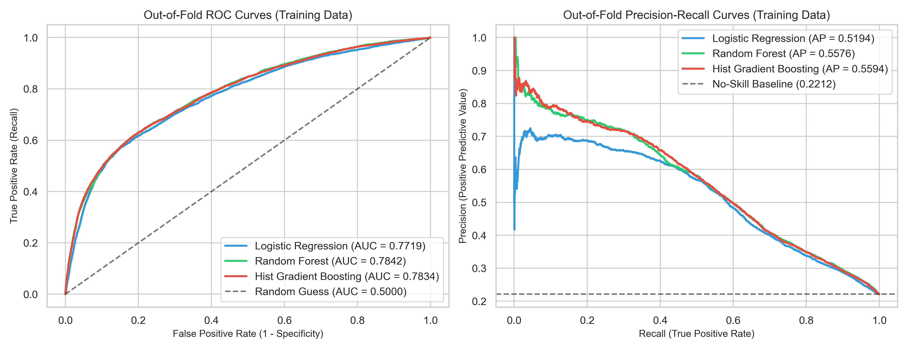
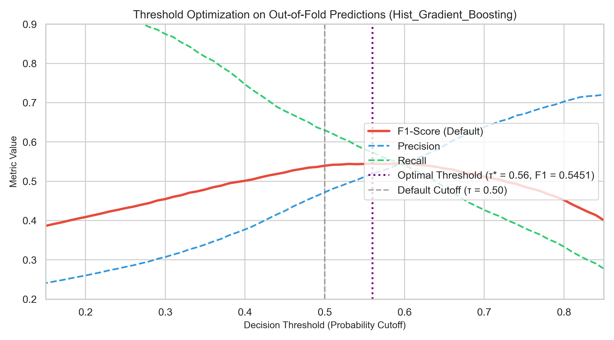
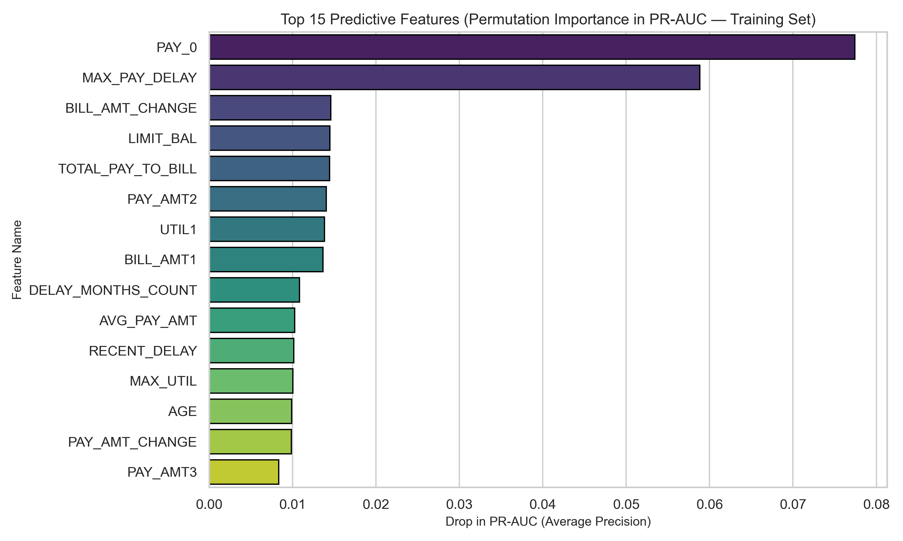

# Phase 6 — Machine Learning Modeling & Training Diagnostics

## Project: Banking Credit Risk & Financial Analytics
**Date**: 2026-08-31  
**Module**: `src/model_training.py` & `src/generate_training_diagnostics.py`

---

## 1. Executive Summary & Problem Formulation

In this phase, we developed an interview-ready, leakage-free Supervised Machine Learning pipeline to predict the probability of credit card default on the next payment (`DEFAULT` $\in \{0, 1\}$) using the 42 features prepared in Phase 5.

### Key Modeling Principles:
1. **Zero Data Leakage Protocol**:
   - `ID` (account identifier) and `DEFAULT` (ground truth label) were excluded from feature matrix $X$.
   - The dataset ($N=30,000$) was partitioned into an **80% Training set** ($N=24,000$) and a **20% Test set** ($N=6,000$) using stratified sampling (`random_state=42`).
   - The test set was immediately sealed in `models/train_test_data.joblib` without calculating any evaluation metrics.
   - All feature encoders and scalers were encapsulated inside `Pipeline` and `ColumnTransformer` objects, ensuring they were fitted **only on the training fold of each cross-validation split**.
2. **Model-Specific Cost-Sensitive Weighting**:
   - Addressed class imbalance (22.12% Default) via `class_weight='balanced'` in Logistic Regression, Random Forest, and HistGradientBoosting.
   - Synthetic oversampling (SMOTE) was deliberately avoided to preserve discrete delinquency codes and eliminate synthetic data leakage.
3. **Training-Only Out-of-Fold Threshold Calibration**:
   - Operating classification cutoffs were optimized using **out-of-fold probability predictions on the training data only**.

---

## 2. 5-Fold Cross-Validation Performance Comparison (Training Data Only)

Cross-validation was executed across 5 stratified folds on the 24,000 training records:

| Model Architecture | Preprocessing Pipeline | CV PR-AUC (Mean ± Std) [Primary] | CV ROC-AUC (Mean ± Std) | CV F1 (Default @ 0.50) | Brier Score | Log Loss | Model Strengths & Business Role |
|---|---|:---:|:---:|:---:|:---:|:---:|---|
| **Logistic Regression** | `StandardScaler` + `OneHotEncoder` | $0.5210 \pm 0.0137$ | $0.7719 \pm 0.0078$ | $0.5295 \pm 0.0055$ | 0.1864 | 0.5659 | Linear benchmark; odds-ratio interpretability; established banking baseline. |
| **Random Forest** | `OneHotEncoder` (Tree Pass-through) | $0.5583 \pm 0.0044$ | $\mathbf{0.7843 \pm 0.0055}$ | $\mathbf{0.5443 \pm 0.0042}$ | $\mathbf{0.1572}$ | $\mathbf{0.4890}$ | Bagged ensemble; captures complex non-linear feature interactions; robust to outliers. |
| **HistGradientBoosting** *(Champion)* | `OneHotEncoder` (Tree Pass-through) | $\mathbf{0.5607 \pm 0.0067}$ | $0.7836 \pm 0.0060$ | $0.5395 \pm 0.0058$ | 0.1761 | 0.5346 | Gradient boosted decision trees; top precision-recall concentration; optimal default ranking. |

---

## 3. Out-of-Fold ROC and Precision-Recall Curves

### Key Analytical Takeaways:
- **PR-AUC Comparison**: While all models achieve comparable ROC-AUC scores ($\approx 0.77 - 0.78$), the tree-based ensembles demonstrate higher PR-AUC ($0.5607$ vs $0.5210$), reflecting higher precision when alerting on top-tier default risks.
- **Champion Selection**: `HistGradientBoostingClassifier` achieved the highest mean CV PR-AUC ($0.5607$) and was selected as the project's champion model.

---

## 4. Decision Threshold Calibration (Training Out-of-Fold Only)

In credit risk classification, using a fixed arbitrary threshold of $0.50$ is suboptimal because the cost of an unmitigated default (False Negative) is significantly higher than the cost of a collections alert (False Positive).

Using the Champion model's out-of-fold probability predictions on the 24,000 training records, we mapped the precision-recall trade-off curve across all candidate thresholds $\tau \in [0.10, 0.90]$:

### Operating Threshold Comparison (Training Data OOF):
| Operating Cutoff | Threshold ($\tau$) | Precision | Recall (Capture Rate) | F1-Score | Business Application / Use Case |
|---|:---:|:---:|:---:|:---:|---|
| **High Recall Policy** | $\tau = 0.40$ | $37.52\%$ | $81.24\%$ | $0.5130$ | Aggressive risk mitigation / automated credit line freezes. |
| **Default Model Cutoff** | $\tau = 0.50$ | $43.57\%$ | $70.99\%$ | $0.5395$ | Standard balanced model output. |
| **Optimal F1 Cutoff** | $\mathbf{\tau^* = 0.56}$ | $\mathbf{47.89\%}$ | $\mathbf{63.27\%}$ | $\mathbf{0.5451}$ | **Primary champion operating threshold** (improves precision by 4.32 percentage points over default 0.50 cutoff while maintaining balanced collections capacity). |
| **High Precision Policy** | $\tau = 0.70$ | $58.12\%$ | $41.80\%$ | $0.4862$ | High-touch, expensive manual investigations. |

---

## 5. Feature Interpretability & Predictive Drivers

Permutation feature importance was computed on the training set using drop in Average Precision (PR-AUC):

### Predictive Insights & Alignment with Phase 3/5:
1. **Recency of Delinquency (`PAY_0`, `RECENT_DELAY`, `MAX_PAY_DELAY`)**: Payment delay status in the most recent billing cycle remains the single strongest predictor of imminent default.
2. **Repayment Compliance (`TOTAL_PAY_TO_BILL`, `PAY_TO_BILL_1`)**: Customers paying only minimum amounts or displaying low payment-to-bill ratios exhibit sharply higher default hazards.
3. **Credit Leverage (`AVG_UTIL`, `MAX_UTIL`, `LIMIT_BAL_LOG`)**: High credit limit utilisation combined with lower credit lines significantly amplifies vulnerability.
4. **Delinquency Trend (`DELINQUENCY_TREND`)**: Accounts with worsening repayment delays from April to September show elevated default risk compared to cured accounts.

---

## 6. Persisted Phase 6 Artifacts

All models, metadata, and data partitions were persisted in `models/`:
- `models/credit_risk_champion_model.joblib`: Fully fitted `HistGradientBoosting` champion pipeline.
- `models/train_test_data.joblib`: Partitioned train and sealed test datasets.
- `models/training_metadata.json`: Complete cross-validation metrics, champion metadata, and optimal threshold.
- `models/oof_predictions.csv`: Out-of-fold probability predictions for all 3 models across the 24,000 training records.
- `models/threshold_curve.csv`: Full precision, recall, and F1 values across candidate thresholds.
