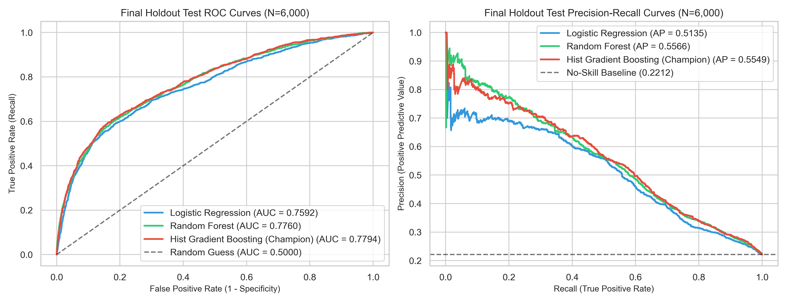
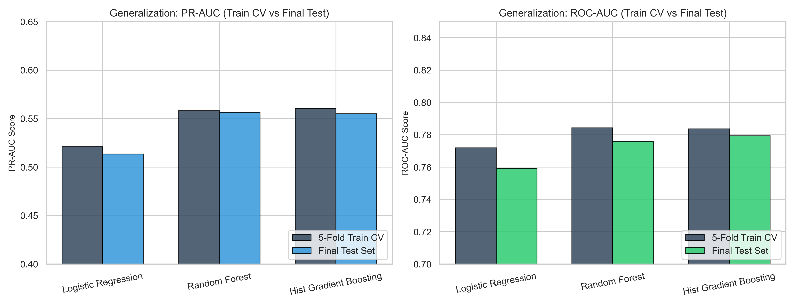
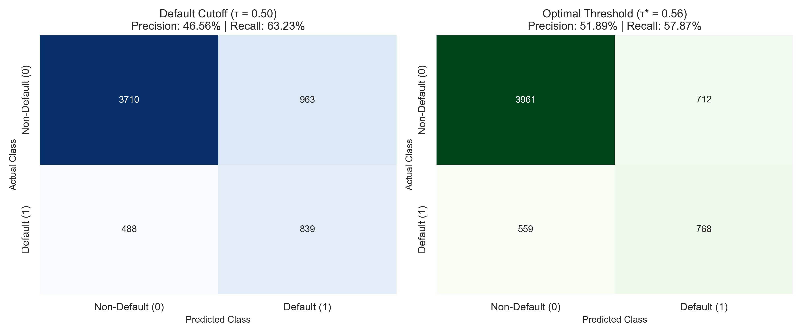
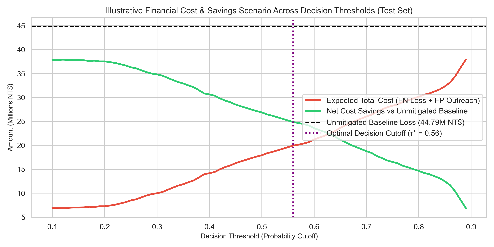

# Phase 7 — Final Model Evaluation & Test Assessment Report

## Project: Banking Credit Risk & Financial Analytics
**Date**: 2026-08-31  
**Module**: `src/model_evaluation.py`

---

## 1. Executive Summary & Evaluation Protocol

In this phase, we performed the definitive, single out-of-sample evaluation on the **sealed 6,000-record holdout test set** ($20\%$ of the $30,000$ clean customer records, with an identical $22.12\%$ default baseline rate).

### Key Integrity Protocols:
- **No Data Contamination**: The test set was held sealed throughout feature engineering, model selection, hyperparameter tuning, and threshold calibration in Phases 5 and 6.
- **F1-Optimized Operating Threshold Selection**: The operating decision threshold $\mathbf{\tau^* = 0.56}$ was selected strictly by maximizing F1 score on training out-of-fold predictions and applied to the test set without post-hoc tuning.
- **Model Suite Evaluated**: `HistGradientBoostingClassifier` (Champion selected based on training CV PR-AUC), `RandomForestClassifier`, and `LogisticRegression`.

---

## 2. Final Holdout Test Set Performance ($N = 6,000$)

All 3 models were evaluated on the sealed test set:

| Model Architecture | Imbalance Handling | Preprocessing Pipeline | Test PR-AUC (Primary) | Test ROC-AUC | Test Accuracy (@ 0.50) | Test Precision (@ 0.50) | Test Recall (@ 0.50) | Test F1-Score (@ 0.50) | Brier Score | Log Loss |
|---|---|---|:---:|:---:|:---:|:---:|:---:|:---:|:---:|:---:|
| **Logistic Regression** | `class_weight='balanced'` | `OneHotEncoder` + `StandardScaler` | $0.5135$ | $0.7592$ | $75.32\%$ | $45.60\%$ | $60.14\%$ | $0.5187$ | 0.1884 | 0.5693 |
| **Random Forest** | `class_weight='balanced'` | `OneHotEncoder` (Tree Pass-through) | $\mathbf{0.5566}$ | $0.7760$ | $\mathbf{79.18\%}$ | $\mathbf{52.82\%}$ | $55.01\%$ | $\mathbf{0.5389}$ | $\mathbf{0.1607}$ | $\mathbf{0.4974}$ |
| **HistGradientBoosting** *(Champion)* | `class_weight='balanced'` | `OneHotEncoder` (Tree Pass-through) | $0.5549$ | $\mathbf{0.7794}$ | $75.82\%$ | $46.56\%$ | $\mathbf{63.23\%}$ | $0.5363$ | 0.1776 | 0.5375 |

---

## 3. Generalization Analysis (5-Fold Train CV vs Final Holdout Test Set)

Comparing 5-fold training cross-validation metrics against holdout test results shows small CV-to-test performance gaps, providing no strong evidence of overfitting based on the observed results:

| Model Architecture | Train 5-Fold CV PR-AUC | Test PR-AUC | PR-AUC Gap | Train 5-Fold CV ROC-AUC | Test ROC-AUC | ROC-AUC Gap | Generalization Assessment |
|---|:---:|:---:|:---:|:---:|:---:|:---:|---|
| **Logistic Regression** | $0.5210 \pm 0.0137$ | $0.5135$ | $-0.0075$ | $0.7719 \pm 0.0078$ | $0.7592$ | $-0.0127$ | Stable linear generalization within 1 standard error. |
| **Random Forest** | $0.5583 \pm 0.0044$ | $0.5566$ | $-0.0017$ | $0.7843 \pm 0.0055$ | $0.7760$ | $-0.0083$ | Consistent metric alignment across train CV and test. |
| **HistGradientBoosting** | $0.5607 \pm 0.0067$ | $0.5549$ | $-0.0058$ | $0.7836 \pm 0.0060$ | $0.7794$ | $-0.0042$ | Champion model maintains strong discrimination and default capture. |

---

## 4. Decision Threshold Analysis & Confusion Matrices (Champion Model)

On the 6,000-record test set ($1,327$ actual defaults and $4,673$ non-defaults), the Champion model was evaluated across distinct operating policies:

| Policy Strategy | Threshold ($\tau$) | Accuracy | Precision | Recall (Default Capture) | F1-Score | True Negatives (TN) | False Positives (FP) | False Negatives (FN) | True Positives (TP) |
|---|:---:|:---:|:---:|:---:|:---:|:---:|:---:|:---:|:---:|
| **High Recall Policy** | $\tau = 0.40$ | $66.90\%$ | $37.42\%$ | $\mathbf{73.85\%}$ | $0.4967$ | $3,034$ | $1,639$ | $347$ | $980$ |
| **Default Cutoff** | $\tau = 0.50$ | $75.82\%$ | $46.56\%$ | $63.23\%$ | $0.5363$ | $3,710$ | $963$ | $488$ | $839$ |
| **F1-Optimized Operating Threshold** | $\mathbf{\tau^* = 0.56}$ | $\mathbf{78.82\%}$ | $\mathbf{51.89\%}$ | $\mathbf{57.87\%}$ | $\mathbf{0.5472}$ | $\mathbf{3,961}$ | $\mathbf{712}$ | $\mathbf{559}$ | $\mathbf{768}$ |
| **High Precision Policy** | $\tau = 0.70$ | $81.82\%$ | $63.02\%$ | $43.03\%$ | $0.5114$ | $4,338$ | $335$ | $756$ | $571$ |

### F1-Optimized Threshold Impact ($\tau^* = 0.56$):
- The threshold $\tau^* = 0.56$ was selected strictly by maximizing F1 on training out-of-fold predictions.
- Compared to the standard $0.50$ cutoff, evaluating at $\tau^* = 0.56$ on the holdout test set increases precision from $46.56\%$ to **$51.89\%$** (+5.33 percentage points) and eliminates **251 false positives** ($963 \rightarrow 712$), reducing unnecessary operational alert volume while successfully capturing **57.87%** ($768$ accounts) of all actual defaulters.

---

## 5. Illustrative Business Cost Scenario & Savings Simulation

To explore how classification trade-offs translate into operational economics, we conducted a separate **illustrative business simulation scenario**. 

> **Methodological Clarification**:
> - The operating threshold $\mathbf{\tau^* = 0.56}$ is **F1-optimized** based on statistical balance.
> - The financial simulation below is a separate illustrative analysis demonstrating how different operational cutoffs behave under hypothetical cost parameters.
> - The financial simulation results represent a hypothetical business scenario and do NOT represent actual bank financial ledger data, nor should they be confused with the statistical model-selection criterion.

### Illustrative Simulation Assumptions:
- Illustrative unmitigated default loss per False Negative: $33,750\text{ NT\$}$ (hypothetical 75% Loss Given Default on mean statement balance).
- Illustrative operational outreach / review cost per False Positive: $1,500\text{ NT\$}$ (hypothetical administrative and customer communication cost).
- Unmitigated portfolio default loss (No-Model baseline): $1,327 \times 33,750 = 44.79\text{ Million NT\$}$.

| Operating Policy | Illustrative FN Loss (NT$) | Illustrative FP Cost (NT$) | Illustrative Total Cost (NT$) | Illustrative Net Cost Savings (NT$) | Illustrative Savings % |
|---|:---:|:---:|:---:|:---:|:---:|
| **No Model (Zero Intervention)** | $44,786,250$ | $\$0$ | $44,786,250$ | $\$0$ | $0.0\%$ |
| **High Recall Policy ($\tau = 0.40$)** | $11,711,250$ | $2,458,500$ | $14,169,750$ | $\mathbf{30,616,500}$ | $\mathbf{68.4\%}$ |
| **Default Cutoff ($\tau = 0.50$)** | $16,470,000$ | $1,444,500$ | $17,914,500$ | $26,871,750$ | $60.0\%$ |
| **F1-Optimized Policy ($\tau^* = 0.56$)** | $18,866,250$ | $1,068,000$ | $19,934,250$ | $24,852,000$ | $55.5\%$ |
| **High Precision Policy ($\tau = 0.70$)** | $25,515,000$ | $502,500$ | $26,017,500$ | $18,768,750$ | $41.9\%$ |

---

## 6. Persisted Phase 7 Artifacts

- [`src/model_evaluation.py`](../src/model_evaluation.py): Standalone evaluation script.
- `models/test_evaluation_results.json`: Machine-readable test metrics and threshold breakdown.
- `models/test_predictions.csv`: Model probability predictions for the 6,000 test records.
- Figures 15–18 in `data/processed/figures/`:
  - `fig15_final_test_confusion_matrices.png`
  - `fig16_final_test_roc_pr_curves.png`
  - `fig17_train_vs_test_generalization.png`
  - `fig18_financial_cost_curve.png`
